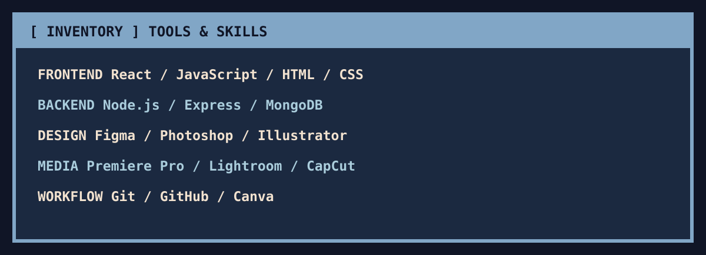
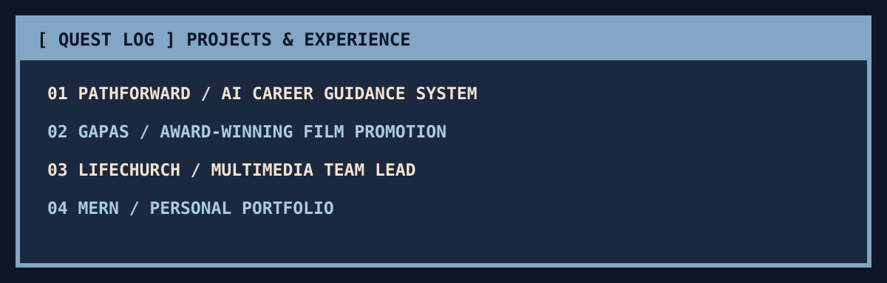

<a href="https://mr-zhiroark-portfolio.vercel.app">🎮 Visit my portfolio</a> · <a href="https://github.com/HiroSaito04">GitHub</a>

## 👾 ABOUT PLAYER 01

I'm **Mike Angelo A. Rubia**, a **BSIT student majoring in Multimedia Arts** at **National University – Manila**, exploring full-stack development, interface design, and multimedia production. I enjoy building responsive digital experiences that combine functionality with creative storytelling.

## 🎒 SKILL INVENTORY

## 🗺️ QUEST LOG

- **PathForward:** AI-assisted career guidance platform with web and mobile components.
- **Gapas:** Award-winning school film; handled social media promotion.
- **Lifechurch Manila:** Multimedia team leadership, content creation, filmmaking, and social media coordination.
- **Portfolio:** [mr-zhiroark-portfolio.vercel.app](https://mr-zhiroark-portfolio.vercel.app)

## 🐍 CONTRIBUTION ACTIVITY

<picture><source media="(prefers-color-scheme: dark)" srcset="https://raw.githubusercontent.com/HiroSaito04/HiroSaito04/output/github-contribution-grid-snake-dark.svg"><source media="(prefers-color-scheme: light)" srcset="https://raw.githubusercontent.com/HiroSaito04/HiroSaito04/output/github-contribution-grid-snake.svg"></picture>

<code>★ THANKS FOR VISITING — QUEST CONTINUES ★</code>

