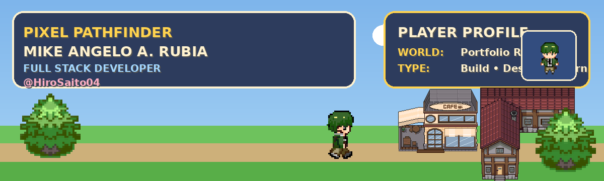
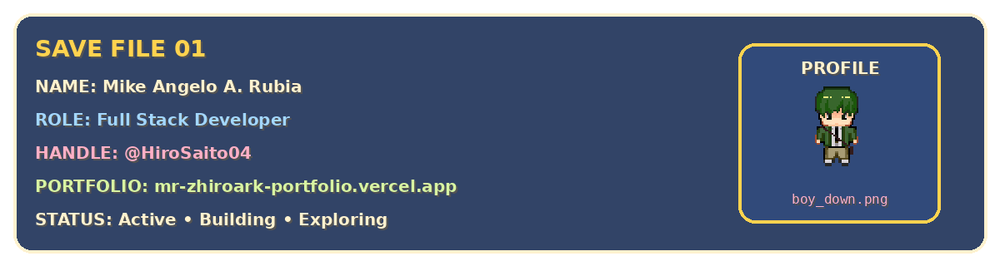
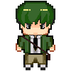
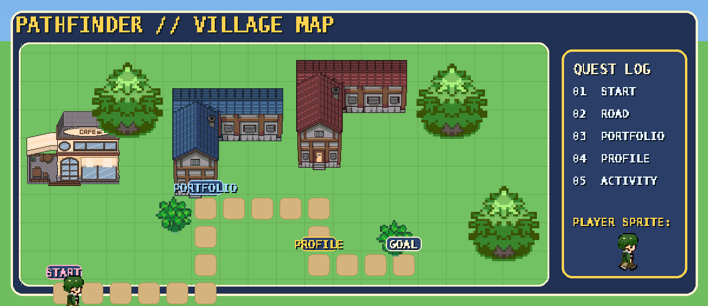
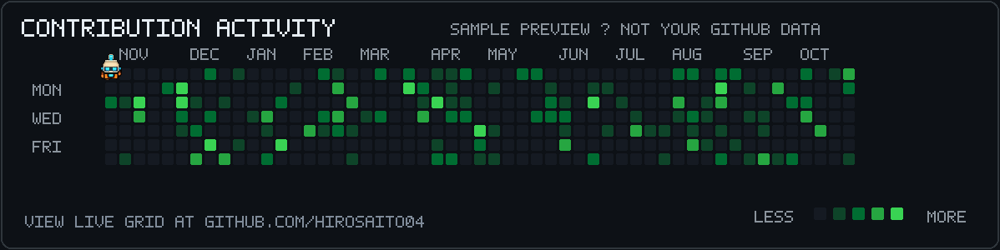

  

  <strong>🎮 PIXEL PATHFINDER</strong>
   
  Pathfinder map + one contribution activity section with Brio

 

  
  

## 💾 Save File

  

  

> **Player Name:** Mike Angelo A. Rubia  
> **Class:** Full Stack Developer  
> **Handle:** `@HiroSaito04`  
> **Profile Sprite:** `boy_down.png`  
> **Main Hub:** [mr-zhiroark-portfolio.vercel.app](https://mr-zhiroark-portfolio.vercel.app)

---

## 🗺️ Pathfinder

  

This map is inspired by the provided TMX village style. The **player** sprite set is used here for the pathfinder movement.

---

## 🐍 Contribution Activity

  

The original contribution section style is kept, but the snake has been replaced with **Brio**. The **brio** sprite set is used for this activity section.

---

  Profile repository for <b>HiroSaito04</b> • ready to push to GitHub

