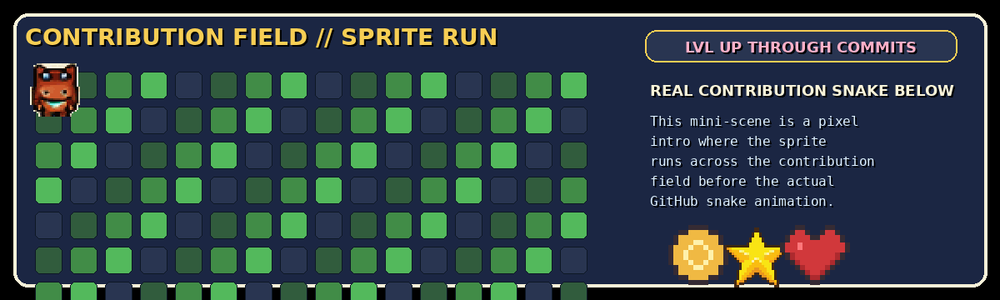

<!-- Pixel Pathfinder profile. Details aligned only to the user's portfolio title and identity. -->

  

  <strong>🎮 PIXEL PATHFINDER</strong>
   
  Retro game styling · Quest map navigation · Animated sprite sections

 

  
  

## 💾 Save File

  

> **Player Name:** Mike Angelo A. Rubia  
> **Class:** Full Stack Developer  
> **Handle:** `@HiroSaito04`  
> **Main Hub:** [mr-zhiroark-portfolio.vercel.app](https://mr-zhiroark-portfolio.vercel.app)

This GitHub profile is styled like a pixel game, but my **portfolio website is still the main source** for my projects and updated work.

---

## 🗺️ Pathfinder

  

Follow the sprite through the quest map:

- **Portfolio Gate** → [Visit portfolio](https://mr-zhiroark-portfolio.vercel.app)
- **Pathfinder Board** → explore this README like a game menu
- **Contribution Zone** → check the animated contribution section below

---

## 🧩 Contribution

  

A pixel intro to the activity zone — then the real GitHub contribution animation continues below.

### 🐍 Contribution Snake

  <picture>
    <source media="(prefers-color-scheme: dark)" srcset="https://raw.githubusercontent.com/HiroSaito04/HiroSaito04/output/github-contribution-grid-snake-dark.svg" />
    <source media="(prefers-color-scheme: light)" srcset="https://raw.githubusercontent.com/HiroSaito04/HiroSaito04/output/github-contribution-grid-snake.svg" />
    
  </picture>

  If the snake is missing, go to <b>Actions</b> and run <b>Generate Snake Animation</b> once.

---

  

