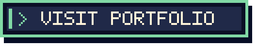
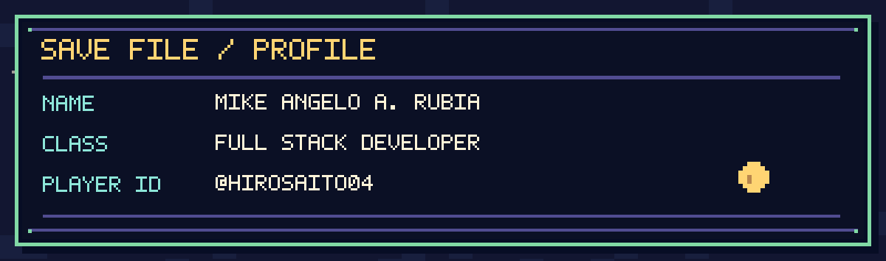
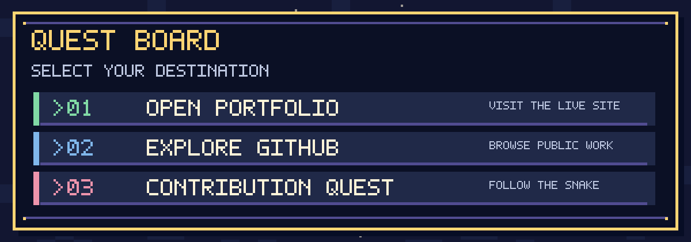
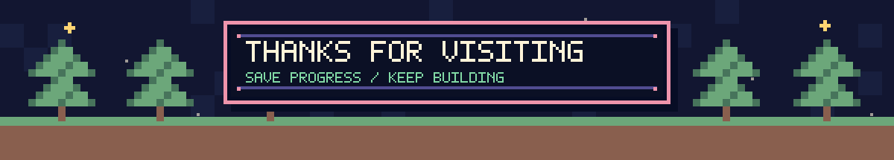

<!--
  PIXEL QUEST / A GitHub profile built from original pixel assets.
  Personal identity and role use ONLY the readable title of the portfolio website.
  Update profile.json and run: python scripts/build_pixel_assets.py
-->

  

  <strong>🎮 PIXEL QUEST · PLAYER PROFILE</strong>
   
  Original 8-bit-inspired artwork · Built for GitHub

 

  
  

## 🗂️ SAVE FILE // PLAYER INFO

  

> **Player:** Mike Angelo A. Rubia  
> **Class:** Full Stack Developer  
> **Main world:** [Official portfolio](https://mr-zhiroark-portfolio.vercel.app)

My website is the **source of truth** for my work and background. Visit it for the latest details instead of relying on a copied list that can go out of date.

## 🗺️ QUEST BOARD // EXPLORE

  

| Quest | Destination |
| :--- | :--- |
| 🟢 **01 · Open Portfolio** | [mr-zhiroark-portfolio.vercel.app](https://mr-zhiroark-portfolio.vercel.app) |
| 🔵 **02 · Explore GitHub** | [github.com/HiroSaito04](https://github.com/HiroSaito04?tab=repositories) |
| 🩷 **03 · Contribution Quest** | [Jump to snake animation](#-contribution-quest--snake) |

## 🐍 CONTRIBUTION QUEST // SNAKE

  <picture>
    <source media="(prefers-color-scheme: dark)" srcset="https://raw.githubusercontent.com/HiroSaito04/HiroSaito04/output/github-contribution-grid-snake-dark.svg" />
    <source media="(prefers-color-scheme: light)" srcset="https://raw.githubusercontent.com/HiroSaito04/HiroSaito04/output/github-contribution-grid-snake.svg" />
    
  </picture>

  The snake updates automatically through GitHub Actions. If it isn't visible yet, run the workflow once from the Actions tab.

 

  

