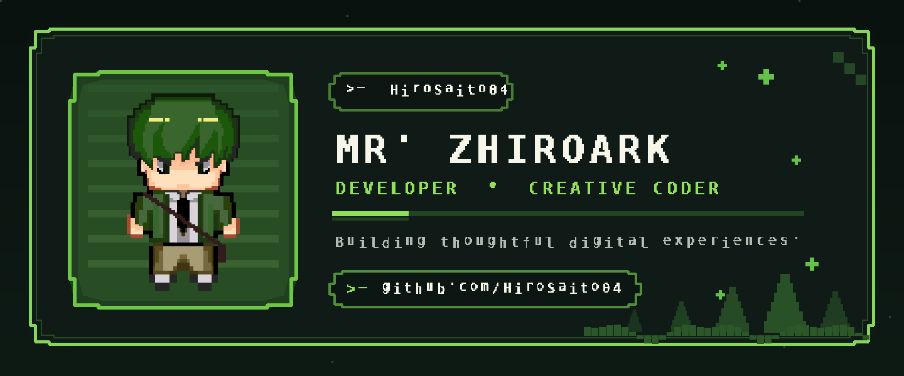

<!--
  PIXEL PATHFINDER / GitHub profile.
  Profile card source: scripts/render_card.py
  Map + Brio animations: scripts/build_profile.py
  Art assets have pixel text and use the provided sprites.
-->

  

  
  

  Mike Angelo A. Rubia · Full Stack Developer · <a href="https://mr-zhiroark-portfolio.vercel.app">Official Portfolio</a>

---

  

A small village quest map inspired by the supplied TMX, with the **Player** sprite walking through the route. My <a href="https://mr-zhiroark-portfolio.vercel.app">portfolio</a> is the main hub for my latest work.

---

  

**Brio** takes the place of the old contribution snake. This is a decorative pixel-game animation, not a live rendering of GitHub contribution counts.

---

  PIXEL PATHFINDER • SAVE PROGRESS • KEEP BUILDING

