<!-- Pixel-terminal visuals adapted from the provided Ryo2702 template. -->
<!-- Edit the profile details below and profile.json, then regenerate the hero SVG. -->
<!-- Setup instructions: SETUP.md -->

<p align="center">
  
</p>

<p align="center">
  <a href="#about"><code>./about</code></a> ·
  <a href="#services"><code>./services</code></a> ·
  <a href="#tech-stack"><code>./tech-stack</code></a> ·
  <a href="#terminal-studies"><code>./terminal-studies</code></a> ·
  <a href="#contribution-activity"><code>./contributions</code></a>
</p>

# `MIKE`

```text
mike@hirosaito04:~$ cat identity.txt
MIKE
IT / MULTIMEDIA ARTS
Responsive applications.
Thoughtful interfaces.
Creative digital projects.
```

> I explore web development and multimedia through practical, responsive, and user-focused projects.

```text
$ status --short
STATUS
  Building and improving my developer portfolio
FOCUS
  Web Development / UI Design / Multimedia
LOCATION
  Philippines
```

---

<a id="about"></a>

## `> cat ./about.txt`

I work on web and mobile development alongside multimedia projects, with an interest in clear interfaces, maintainable code, and thoughtful visual presentation.

`PIPELINE: UNDERSTAND → PLAN → BUILD → TEST → IMPROVE`

<p align="center">
  
</p>

---

<a id="services"></a>

## `> ls ./services`

### `drwxr-xr-x  01  WEB DEVELOPMENT`

Responsive web interfaces and applications, built around real user needs and maintainable code.

### `drwxr-xr-x  02  UI & VISUAL DESIGN`

Interface design and visual content with a focus on clarity, organization, and accessibility.

### `drwxr-xr-x  03  MULTIMEDIA PRODUCTION`

Video editing, creative assets, and digital content for multimedia projects.

---

<a id="tech-stack"></a>

## `> inspect ./tech-stack`

| AREA | TECHNOLOGIES |
| :--- | :--- |
| `FRONTEND` | `React` · `JavaScript` · `HTML` · `CSS` |
| `BACKEND` | `Node.js` · `Express` |
| `DATABASE` | `MongoDB` |
| `DESIGN / MEDIA` | `Figma` · `Photoshop` · `Illustrator` · `Premiere Pro` |
| `TOOLS` | `Git` · `GitHub` · `Canva` · `CapCut` |

---

<a id="terminal-studies"></a>

## `> run ./terminal-studies`

<p>
  
</p>

<p>
  
</p>

---

<a id="contribution-activity"></a>

## 🐍 Contribution Activity

<div align="center">

<picture>
  <source media="(prefers-color-scheme: dark)" srcset="https://raw.githubusercontent.com/HiroSaito04/HiroSaito04/output/github-contribution-grid-snake-dark.svg" />
  <source media="(prefers-color-scheme: light)" srcset="https://raw.githubusercontent.com/HiroSaito04/HiroSaito04/output/github-contribution-grid-snake.svg" />
  
</picture>

</div>

<!-- The snake graphic will show only AFTER the Generate Snake Animation workflow succeeds. -->
<!-- This profile README is configured for github.com/HiroSaito04. -->

```text
mike@hirosaito04:~$ exit
Process finished successfully.
```
