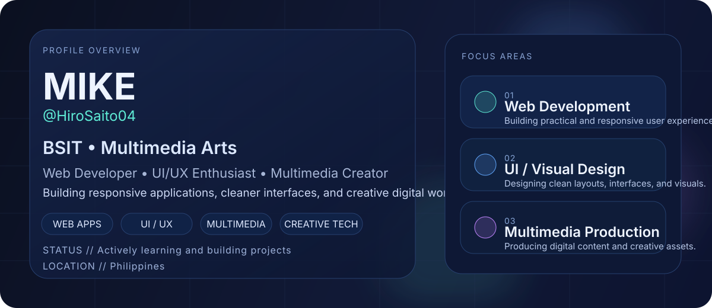
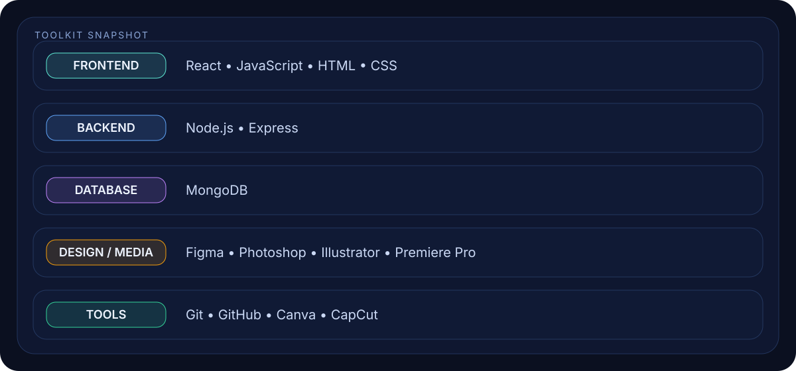
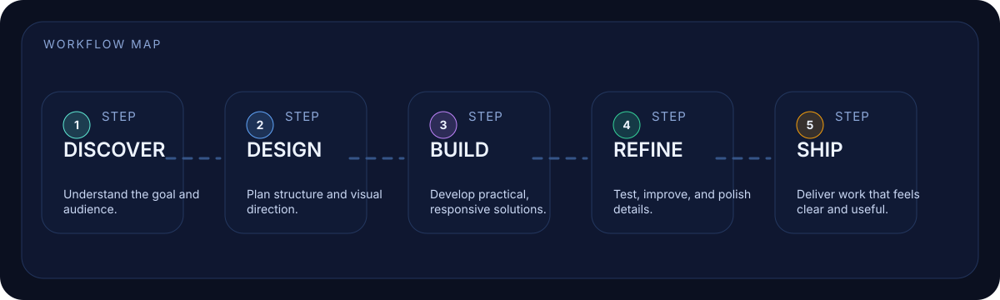

  

  <a href="#about">About</a> •
  <a href="#toolkit">Toolkit</a> •
  <a href="#workflow">Workflow</a> •
  <a href="#contribution-activity">Contribution Activity</a>

# Hi, I'm MIKE 👋

I’m a **BSIT student majoring in Multimedia Arts** who enjoys blending **web development, UI thinking, and creative media work** into clean and practical digital experiences.

- 🌱 Currently learning and building more in **full-stack development**
- 🎨 Interested in **UI / visual design** and clear digital presentation
- 🛠️ Working with **React, Node.js, Express, MongoDB**, and creative tools
- 📍 Based in the **Philippines**

---

## About

  

I like building projects that are not only functional, but also visually clear and thoughtful. My focus is on creating responsive interfaces, improving user experience, and using multimedia skills to make projects feel polished and engaging.

---

## Toolkit

  

### Core Stack

- **Frontend:** React, JavaScript, HTML, CSS
- **Backend:** Node.js, Express
- **Database:** MongoDB
- **Design / Media:** Figma, Photoshop, Illustrator, Premiere Pro
- **Tools:** Git, GitHub, Canva, CapCut

---

## Workflow

  

I usually approach projects by first understanding the goal, planning the direction, building the solution, refining the details, and then shipping something that feels clean, useful, and presentable.

---

## Contribution Activity

<picture>
  <source media="(prefers-color-scheme: dark)" srcset="https://raw.githubusercontent.com/HiroSaito04/HiroSaito04/output/github-contribution-grid-snake-dark.svg" />
  <source media="(prefers-color-scheme: light)" srcset="https://raw.githubusercontent.com/HiroSaito04/HiroSaito04/output/github-contribution-grid-snake.svg" />
  
</picture>

---

  <i>Thanks for visiting my profile.</i>

